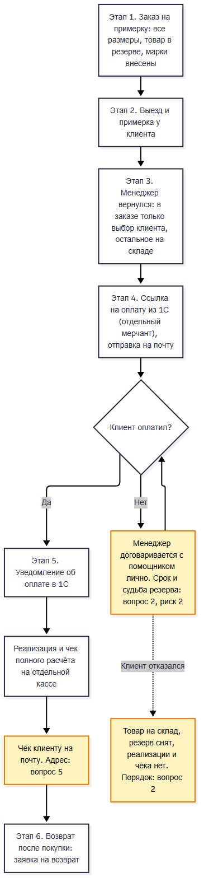
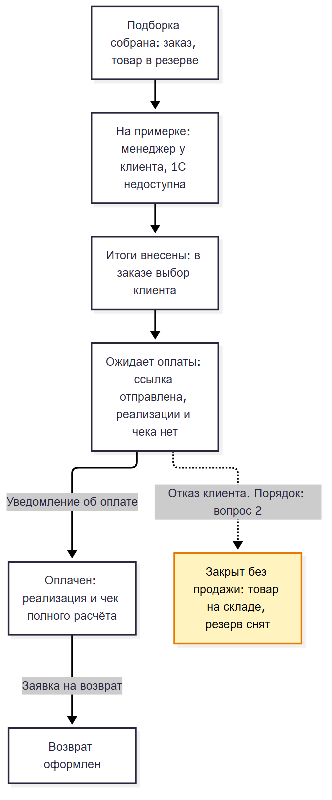
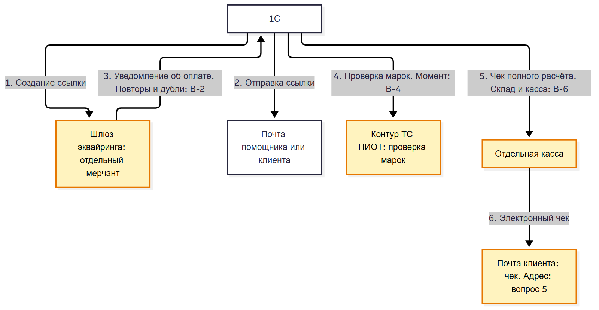

# Выездная примерка для VIP-клиентов: пакет на согласование

## 0. Шапка

**Версия:** 2

| Поле | Значение |
|---|---|
| Название | Выездная примерка для VIP-клиентов: процесс от заказа до чека и возврата |
| Версия | 2 |
| Дата | 2026-11-09 |
| Статус | Черновик, на согласование не отправлен |
| Подготовил | аналитик 1С |
| Согласующие | директор по развитию розничных продаж (автор постановки); владелец процесса (имя в источниках не названо, совпадение с автором постановки не установлено); бухгалтерия (роль, имя не названо) |
| Что подписывается | Решения Р-1..Р-8 (раздел 2), процесс по этапам (раздел 3), риски с владельцами (раздел 7), критерии приёмки (раздел 10). Решения Р-1, Р-2, Р-3, Р-6, Р-7, Р-8 подтверждены владельцем процесса письмом от 2026-11-09 в формулировках версии 1. Подпись пакета означает согласие с остальными решениями (Р-4, Р-5) и принятие рисков, по которым владелец дал ответ |
| Журнал изменений | CHANGELOG.md в папке пакета |

Статусы решений в этой версии: Р-1, Р-2, Р-3, Р-6, Р-7, Р-8 имеют статус «Подтверждено» (письмо владельца процесса от 2026-11-09, формулировки версии 1 не менялись). Р-4 и Р-5 остаются «Предложено»: владелец процесса не подтвердил их до ответа бухгалтерии по моменту чека и решения по сроку ожидания оплаты. Пакет подписью не закрыт, подтверждение бухгалтерии запрошено и не получено.

## 1. Термины

| Термин | Значение |
|---|---|
| VIP-клиент | Клиент, которому товар привозят домой на примерку. Платит не сразу, как правило через помощника |
| Выездная примерка | Менеджер привозит клиенту подборку (несколько размеров и вариантов), клиент выбирает, остальное менеджер забирает обратно |
| Заказ на примерку | Заказ в 1С, в который включены все привозимые размеры и варианты. Товар в нём стоит в резерве. Заказ шире, чем будущая покупка |
| Резерв | Закрепление товара за заказом без отгрузочного документа. Другие продажи этот товар не занимают |
| Ссылка на оплату | Ссылка (обычная или QR-код) на страницу оплаты банковской картой. Формируется по заказу после того, как клиент выбрал товар |
| Мерчант | Подключение магазина к банковскому эквайрингу со своими настройками. Для VIP-продаж запрашивается отдельный мерчант |
| Уведомление об оплате | Сообщение банка о том, что клиент оплатил. Для отдельного мерчанта приходит в 1С |
| Реализация | Документ продажи в 1С. По этому процессу оформляется только после оплаты |
| Чек полного расчёта | Кассовый чек, который подтверждает оплату всей суммы покупки. Уходит клиенту на почту |
| Заявка на возврат | Документ, по которому оформляется возврат купленного товара. Заменяет заказ в обратном направлении |
| Марка | Код маркировки на товаре, который подлежит обязательной маркировке. Заносится в заказ и проверяется |
| Помощник клиента | Сотрудник клиента, с которым менеджер договаривается об оплате и на чью почту обычно уходит ссылка |

## 2. Решения

**Р-1. Ссылка на оплату формируется в 1С после примерки, по заказу, откорректированному под выбор клиента.** Заказ на примерку содержит больше товара, чем клиент купит, поэтому ссылка, созданная заранее, показала бы неверную сумму. Отвергнуто: ссылка заранее (заказ содержит непокупаемое); ссылку формирует сайт (теряется связь с 1С, 1С пришлось бы получать ссылку обратно); доработка силами подрядчика сайта (заказчик не хочет пускать подрядчика в свои доработки и берёт задачу на себя). Связь с сайтом отложена на будущее. Источник: встреча 1, F3, F4, F9-F12. Статус: Подтверждено (письмо владельца процесса от 2026-11-09).

**Р-2. Для VIP-продаж запрашивается отдельный мерчант эквайринга с более длинным сроком жизни ссылки, уведомления об оплате приходят в 1С.** Ссылка текущего мерчанта живёт 20 минут, а VIP-клиенты платят с задержкой в дни. Уведомления текущего мерчанта уходят на сайт, и сайт получил бы сигнал об оплате незнакомого ему заказа. Отвергнуто: менять срок жизни ссылки в заказе у текущего мерчанта (документацией шлюза не подтверждено, ответ на вопрос Q-E1 не получен). Источник: ADR-0001 (статус proposed), встреча 1, F14-F16. Статус: Подтверждено (письмо владельца процесса от 2026-11-09).

**Р-3. Для VIP-продаж используется отдельная касса; отдельного склада для товара на примерке нет, товар держится резервом в заказе.** Чеки привязаны к складам, поэтому для отдельного потока нужна отдельная касса, тариф порядка 14 тысяч, период оплаты не подтверждён (вопрос 3 раздела 11). Отвергнуто: отдельный склад (ответ владельца процесса). Источник: встреча 1, F18; ответы заказчика, вопрос Q-P4. Статус: Подтверждено (письмо владельца процесса от 2026-11-09).

**Р-4. Реализация и чек полного расчёта создаются только по факту оплаты.** Товар передаётся клиенту до оплаты без чека и без отгрузочного документа. Причина: VIP-клиент может отказаться от товара в последний момент, а при оформленных реализации и чеке «передача в кредит» и закрытом бухгалтерией периоде разбор требует ручных действий и согласования. Отвергнуто: реализация при передаче товара, чек «передача в кредит», затем чек «оплата кредита». Решение расходится с позицией ФНС о передаче товара до оплаты как расчёте `[ПРОВЕРЬ]`: ссылка на норму или разъяснение в источниках не приведена. Риск передан бухгалтерии, подтверждение запрошено и не получено (риск 1, вопрос 1). Источник: ADR-0002 (статус proposed), ответ владельца процесса на вопрос Q-P1, встреча 2. Статус: Предложено.

**Р-5. Автоматических напоминаний об оплате нет; об оплате менеджер договаривается лично с помощником клиента.** Менеджеры не общаются с клиентом об оплате напрямую, а помощникам напоминать не нужно; личный контакт проще. Отвергнуто: напоминания, которые рассылает 1С. Срок ожидания оплаты и судьба товара и резерва по истечении срока не определены (риск 2, вопрос 2). Источник: встреча 2, ответ на вопрос Q-P2. Статус: Предложено.

**Р-6. В заказ входит только товар; оплата подарочными сертификатами вне этого этапа; бонусы программы лояльности применяются как скидка на покупку.** Платной доставки и платной примерки нет. Отдельного способа оплаты бонусами не создаётся. Сертификаты и оплата бонусами были в постановке, поэтому подпись под этим решением означает отказ от них на этом этапе. Отвергнуто на этом этапе: частичная оплата сертификатами; оплата бонусами как самостоятельный способ оплаты; услуги в заказе. Источник: письмо-постановка, ответы заказчика (услуги, сертификаты, бонусы), встреча 2. Статус: Подтверждено (письмо владельца процесса от 2026-11-09).

**Р-7. Возврат после покупки повторяет схему продажи: вместо заказа оформляется заявка на возврат.** Возвраты единичны (за всё время были один-два случая), поэтому отдельный сложный процесс не создаётся. Источник: встреча 2, ответ владельца процесса. Статус: Подтверждено (письмо владельца процесса от 2026-11-09).

**Р-8. Итоги примерки менеджер вносит в 1С после возвращения с выезда; менеджер и кладовщик в этом процессе один человек.** Доступа менеджера к 1С на выезде пока нет, настройка доступов может занять время. Планшеты в планах, процесс от этого не меняется. Отвергнуто на этом этапе: ввод итогов на месте с планшета. Источник: встреча 2, ответ владельца процесса. Статус: Подтверждено (письмо владельца процесса от 2026-11-09).

## 3. Процесс по этапам

<!-- D1: этапы 1-6, процесс целиком -->

### Этап 1. Заказ на примерку

1.1. Менеджер, который ведёт клиента, создаёт в 1С заказ на примерку и включает в него все размеры и варианты, которые собирается привезти. Товар сразу встаёт в резерв (Р-3).

1.2. Менеджер собирает заказ сам, как кладовщик (Р-8).

1.3. В заказ заносятся марки товара; проверка марок идёт через существующий контур, как в остальных процессах. Момент проверки `[ПРОВЕРЬ]`: источники его не называют (вопрос В-4 раздела 8).

### Этап 2. Выезд и примерка

2.1. Менеджер привозит подборку клиенту домой, клиент примеряет и выбирает.

2.2. Менеджер на выезде не работает в 1С; итоги записываются позже (Р-8).

### Этап 3. Внесение итогов

3.1. Вернувшись, менеджер открывает заказ в 1С и оставляет в нём только то, что выбрал клиент (Р-1).

3.2. Невыбранный товар возвращается на склад и удаляется из заказа, резерв по нему снимается.

3.3. Заказ получает итоговую сумму и переходит в состояние «Итоги внесены» (раздел 4).

<!-- S1: этап 3, корректировка заказа после примерки -->

### Этап 4. Ссылка на оплату и ожидание оплаты

4.1. Менеджер формирует ссылку на оплату по откорректированному заказу в отдельном мерчанте (Р-1, Р-2).

4.2. Менеджер отправляет ссылку на почту, чаще всего это почта помощника клиента. Ссылка может быть обычной или QR-кодом; её можно распечатать как бланк заказа.

4.3. О сроках оплаты менеджер договаривается с помощником лично; автоматических напоминаний нет (Р-5). Ссылка живёт дольше стандартных 20 минут; точный срок определит ответ банка и вопрос 2 раздела 11.

4.4. Пока оплаты нет, товар находится у клиента, а заказ остаётся в резерве, реализации и чека нет (Р-4).

<!-- S2: этап 4, формирование и отправка ссылки на оплату -->

### Этап 5. Оплата, реализация и чек

5.1. Клиент оплачивает картой по ссылке. Банк присылает уведомление об оплате в 1С (Р-2), оплата загружается в 1С как операция эквайринга.

5.2. 1С создаёт реализацию и пробивает чек полного расчёта на отдельной кассе (Р-3, Р-4).

5.3. Чек уходит клиенту на почту электронно. Адрес для чека не определён (вопрос 5 раздела 11).

### Этап 6. Возврат после покупки

6.1. Если клиент хочет вернуть купленный товар, менеджер оформляет заявку на возврат вместо заказа (Р-7). Возвращается только товар: услуг в заказе нет (Р-6).

## 4. Состояния

Состояния выведены из этапов процесса и предложены аналитиком; с заказчиком их список не обсуждался.

<!-- D2: этапы 1-6, состояния заказа и переходы между ними -->

| Состояние | Как попадаем | Что доступно | Что видит пользователь |
|---|---|---|---|
| Подборка собрана | Менеджер создал заказ на примерку, товар в резерве | Редактирование состава, занесение и проверка марок | Заказ с полным набором размеров и вариантов, товар в резерве |
| На примерке | Менеджер выехал к клиенту | В 1С менеджер не работает (Р-8) | Заказ без изменений до возвращения менеджера |
| Итоги внесены | Менеджер оставил в заказе выбор клиента, остальное вернул на склад | Формирование ссылки на оплату | Заказ только с выбранным товаром и итоговой суммой |
| Ожидает оплаты | Ссылка сформирована и отправлена | Повторная отправка ссылки `[ПРОВЕРЬ]`, закрытие заказа при отказе клиента `[ПРОВЕРЬ]` | Заказ в резерве, реализации и чека нет, срок ссылки |
| Оплачен | 1С получила уведомление об оплате | Просмотр реализации и чека, оформление заявки на возврат | Реализация, чек полного расчёта, оплата по заказу |
| Закрыт без продажи | Клиент отказался от выбранного товара до оплаты, товар вернулся на склад `[ПРОВЕРЬ]` | Только просмотр | Заказ без реализации и чека, резерв снят |
| Возврат оформлен | Менеджер оформил заявку на возврат по оплаченному заказу | Просмотр заявки | Заявка на возврат вместо заказа |

## 5. Исключения и сбои

| Ситуация | Что происходит | Кто действует |
|---|---|---|
| Клиент платит позже, чем ожидалось | Автоматических напоминаний нет, товар остаётся у клиента, заказ в резерве. Предельный срок ожидания не определён (вопрос 2 раздела 11) | Менеджер, лично через помощника клиента |
| Клиент отказывается от выбранного товара до оплаты | Реализация и чек не оформлены, поэтому отменять в учёте нечего; товар возвращается на склад, резерв снимается `[ПРОВЕРЬ]`: порядок в источниках не описан | Менеджер |
| Клиент ничего не выбрал | Весь товар возвращается на склад, заказ закрывается `[ПРОВЕРЬ]`: случай в источниках не описан | Менеджер |
| Срок жизни ссылки истёк до оплаты | Нужна новая ссылка `[ПРОВЕРЬ]`: порядок в источниках не описан | Менеджер |
| Ссылка не создалась | Оплата откладывается; порядок восстановления не спроектирован (вопрос В-3 раздела 8). Во временном режиме ссылки формируются вручную | Определится в разделе 8 |
| Уведомление об оплате потерялось или пришло дважды | Клиент оплатил, а заказ не изменился, либо возникают две реализации и два чека; защита от дублей и повторная доставка не спроектированы (вопросы В-2, В-3 раздела 8) | Определится в разделе 8 |
| Возврат после покупки | Оформляется заявка на возврат вместо заказа. Случаи единичны | Менеджер |
| У менеджера нет доступа к 1С на выезде | Итоги вносятся после возвращения, процесс не меняется (Р-8) | Менеджер |

## 6. Предметные блоки

**Чеки и фискализация.**

- Чек полного расчёта создаётся только после оплаты; чека «передача в кредит» нет (Р-4, ADR-0002).
- Чек уходит клиенту электронно, предпочтительный канал почта (встреча 1, F6). Адрес не определён (вопрос 5 раздела 11).
- Для VIP-продаж нужна отдельная касса (Р-3, встреча 1, F18).
- Утверждение «передача товара до оплаты является расчётом по позиции ФНС» взято из ADR-0002 без ссылки на документ `[ПРОВЕРЬ]`. Требуется подтверждение бухгалтерии и ссылка на норму (вопрос 1 раздела 11).

**Маркировка.**

- Заказ формируется с занесением марок (встреча 1, F8). Проверка идёт через существующий контур ТС ПИОТ, чтобы работать так же, как остальные контуры (встреча 1, F17).
- Момент вывода марок из оборота при схеме «реализация по факту оплаты» источники не называют `[ПРОВЕРЬ]`. Нормативная часть вопроса входит в подтверждение бухгалтерии по вопросу 1 раздела 11, технический момент проверки в вопрос В-4 раздела 8.

## 7. Риски на подпись

| Риск | Владелец | Последствия | Вариант Б | Статус |
|---|---|---|---|---|
| 1. Реализация и чек по факту оплаты расходятся с позицией ФНС о передаче товара до оплаты `[ПРОВЕРЬ]` | Бухгалтерия | Товар находится у клиента без отгрузочного документа и без чека. Схема может быть признана некорректной, тогда её придётся переделывать | Реализация при передаче товара и чек «передача в кредит», затем чек «оплата кредита» (вариант 1 из ADR-0002). Отвергнут из-за разбора закрытых периодов при отказе клиента. Как запасной вариант это предложение аналитика, с бухгалтерией не обсуждалось | Не принят: подтверждение бухгалтерии запрошено и не получено |
| 2. Клиент долго не платит или не платит: товар у клиента, резерв висит, учёта нет | Владелец процесса | Расхождение остатков, повтор прошлого случая, когда товар отдали без отражения в учёте и остатки не сошлись | Не сформулирован | Не может быть принят: нет предельного срока и действий по его истечении (вопрос 2 раздела 11) |
| 3. Отдельный мерчант окажется ненужным, если банк подтвердит срок жизни ссылки в заказе | Владелец процесса | Время и расходы на запрос и настройку отдельного мерчанта, которых можно было бы избежать | Менять срок жизни ссылки в заказе у текущего мерчанта (вариант 1 из ADR-0001). Зависит от ответа банка, который не получен | На решении: ждёт ответа банка (вопрос В-1 раздела 8) |
| 4. Тариф отдельной кассы (порядка 14 тысяч) указан без периода, возможны расходы больше ожидаемых | Владелец процесса | Бюджетные расходы выше ожидаемых, если тариф годовой, а не месячный, либо наоборот `[ПРОВЕРЬ]` | Не сформулирован | Не может быть принят: период тарифа и согласие на расход не подтверждены (вопрос 3 раздела 11) |
| 5. Срок запуска сдвигается: в источниках январь и первый квартал 2027 года, команда разработки занята параллельным проектом | Владелец процесса | Целевой процесс запускается позже, VIP-продажи дольше идут вручную | Временный режим: новый мерчант и ссылки, формируемые вручную (встреча 1, F19) | На решении: срок не согласован (вопрос 4 раздела 11) |

## 8. Интеграции

Раздел является приложением для разработки.

<!-- D3: потоки между 1С, эквайрингом, кассой, контуром маркировки и почтой -->

| № | Поток | Откуда и куда | Данные | Когда | Ошибки и повторы |
|---|---|---|---|---|---|
| 1 | Создание ссылки на оплату | 1С в шлюз эквайринга, отдельный мерчант | Сумма заказа, идентификатор заказа, срок жизни ссылки `[ПРОВЕРЬ]` | После внесения итогов примерки | Сбой создания: порядок не определён (В-3) |
| 2 | Отправка ссылки | 1С на почту помощника или клиента | Ссылка или QR-код | После создания ссылки | Ошибка доставки не рассмотрена |
| 3 | Уведомление об оплате | Шлюз эквайринга (отдельный мерчант) в 1С | Факт и сумма оплаты, идентификатор заказа | При оплате клиентом | Маршрут, протокол, повторная доставка и защита от дублей не спроектированы (В-2) |
| 4 | Проверка марок | 1С в контур ТС ПИОТ | Марки товара | Момент не определён `[ПРОВЕРЬ]` (В-4) | Совместимость существующего контура не проверена |
| 5 | Фискализация | 1С в отдельную кассу | Чек полного расчёта | После получения оплаты | Привязка кассы к складу при отсутствии отдельного склада не определена (В-6) |
| 6 | Отправка чека | Касса или 1С на почту | Электронный чек | После пробития чека | Адрес получателя не определён (вопрос 5 раздела 11) |

Вопросы для разработки, которые не идут заказчику:

| № | Вопрос | Основание |
|---|---|---|
| В-1 | Допускает ли шлюз переопределение срока жизни ссылки в заказе и какой параметр побеждает при конфликте с настройкой мерчанта. Ответ на вопрос о сроке жизни ссылки не получен | Q-E1, гипотеза H2; Р-2, риск 3 |
| В-2 | Как уведомление нового мерчанта попадает в 1С: протокол, повторная доставка, защита от дублей, безопасность совместного использования до отдельного мерчанта | Q-E2, пробелы G4, G5, гипотеза H3 |
| В-3 | Что происходит, когда ссылка не создалась или уведомление потерялось: повторные попытки, ручное восстановление, мониторинг | Q-E3, пробел G5 |
| В-4 | Контур ТС ПИОТ: используется как есть или нужны доработки под VIP, в какой момент проверяются марки и выводятся из оборота при схеме «по факту оплаты» | Q-E4, гипотеза H5 |
| В-5 | Какие объекты и команды обновлённого блока эквайринга (новая версия интернет-магазина) переиспользуются | Q-E5, F13 |
| В-6 | Касса привязана к складу, но отдельного склада нет, товар держится резервом: как связать кассу и склад | Источники расходятся: F18 (встреча 1) и ответ на вопрос Q-P4 |
| В-7 | Тестовый контур шлюза и кассы и критерии готовности к приёмке не определены | Пробел G9 |

## 9. Данные, роли, персональные данные

Раздел является приложением для разработки.

**Новые данные и где хранятся.**

- Заказ на примерку с резервом, итогами примерки, состоянием (раздел 4), ссылкой на оплату, сроком её жизни и признаком отправки.
- Адрес выезда клиента и адрес электронной почты для ссылки и чека (почта помощника или клиента). Таблица менеджера с клиентами, адресами, товарами и датами упомянута в письме, но в источники не приложена; перенос данных из неё не определён `[ПРОВЕРЬ]`.
- Данные об оплате (операция эквайринга) и привязка к реализации и чеку.
- Место хранения данных не определено (вопрос В-8).

**Роли и права.**

- Менеджер: создаёт и корректирует заказ, формирует и отправляет ссылку, оформляет заявку на возврат; он же кладовщик (Р-8).
- Бухгалтерия: подтверждает схему чека (вопрос 1 раздела 11); права на документы продажи и кассу не определены.
- Набор ролей и прав в 1С не определён (вопрос В-8).

**Персональные данные.**

- Появляются адреса выезда, адреса электронной почты клиентов и их помощников.
- Кто видит эти данные, где хранятся и как защищены, не рассмотрено (пробел G6, вопрос Q-E6, вопрос В-8).

| № | Вопрос | Основание |
|---|---|---|
| В-8 | Где хранятся адреса выезда и почты, какие роли их видят и как устроены права менеджера и бухгалтерии | Q-E6, пробел G6 |

## 10. Критерии приёмки

| № | Сценарий | Исходное состояние | Действие | Ожидаемый результат |
|---|---|---|---|---|
| А-1 | Основной: оплата сразу после примерки | Заказ на примерку с несколькими позициями в резерве, марки внесены | Менеджер оставляет выбранное, формирует ссылку и отправляет на почту; клиент оплачивает | Невыбранный товар на складе и вне заказа; после уведомления об оплате созданы реализация и чек полного расчёта; чек ушёл на почту |
| А-2 | Граничный: оплата через несколько дней | Ссылка отправлена, оплаты нет, прошло больше 20 минут | Клиент оплачивает по ссылке позже | Ссылка действует; заказ оставался в резерве, реализации и чека до оплаты не было; после оплаты они созданы один раз |
| А-3 | Граничный: повторное уведомление об оплате | Оплата уже получена, реализация и чек созданы | Банк присылает уведомление повторно | Вторых реализации и чека нет `[ПРОВЕРЬ]`: поведение не определено, см. В-2 |
| А-4 | Отказный: отказ от выбранного товара до оплаты | Ссылка отправлена, оплаты нет | Клиент отказывается от покупки | Реализации и чека нет, товар возвращён на склад, резерв снят `[ПРОВЕРЬ]`: порядок уточняется вопросом 2 раздела 11 |
| А-5 | Возврат после покупки | Заказ оплачен, реализация и чек созданы | Клиент возвращает товар | Менеджер оформляет заявку на возврат вместо заказа |

## 11. Открытые вопросы

| № | Вопрос | Адресат | Что блокирует | Срок |
|---|---|---|---|---|
| 1 | Подтверждает ли бухгалтерия схему «реализация и чек полного расчёта только после оплаты», включая момент вывода марок из оборота, принимает ли она расхождение с позицией ФНС (риск 1), и допустим ли при отказе запасной вариант Б | Бухгалтерия | Р-4, риск 1, критерии А-1, А-3, раздел 6 | До подписи пакета; срок не назван |
| 2 | Какой предельный срок ожидания оплаты и что делаем по его истечении: снимаем резерв, возвращаем товар, кто решает; этот срок задаёт и срок жизни ссылки | Владелец процесса | Р-5, риск 2, критерии А-2, А-4 | До подписи пакета; срок не назван |
| 3 | Подтверждается ли тариф отдельной кассы порядка 14 тысяч, за какой период (год или месяц) и принимается ли этот расход | Владелец процесса | Р-3, риск 4 | До подписи пакета; срок не назван |
| 4 | К какому сроку нужен временный режим (новый мерчант, ссылки вручную) и к какому целевой процесс: январь или первый квартал 2027 года | Владелец процесса | Риск 5, план работ | До подписи пакета; срок не назван |
| 5 | На какой адрес отправлять чек: почта клиента или почта помощника (ссылка уходит на почту помощника, чек предназначен клиенту) | Владелец процесса | Этап 5, поток 6 раздела 8 | До подписи пакета; срок не назван |

Технические вопросы реализации вынесены в разделы 8 и 9 (В-1..В-8).
