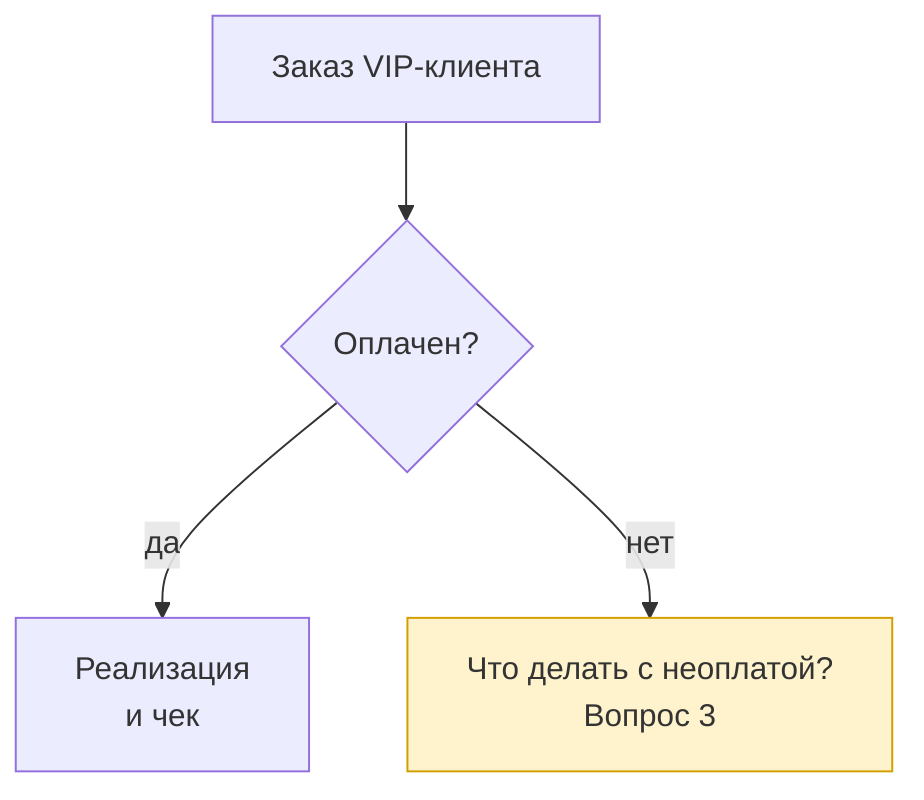

# Схемы Mermaid для аналитика

Схема пишется текстом в файле `.mmd` и отрисовывается в PNG командой `mmdc`.
Текст схемы хранится рядом с документом, поэтому схему можно исправить и
перерисовать, а изменения видны в истории Git.

## Жёсткие границы

- Схема отражает только то, что написано в исходном документе. Шаги, стрелки и
  условия, которых в тексте нет, не рисуются.
- Неопределённое место показывается отдельным блоком с выделением и номером
  открытого вопроса из документа (`classDef open`, пример ниже). Догадка на
  схеме не ставится вместо вопроса.
- Работа считается законченной, только когда PNG создан и открыт для проверки
  читаемости текста. Код выхода `mmdc` 0 этого не доказывает.

## Выбор вида схемы

| Что показать | Вид | Начало файла |
|---|---|---|
| Процесс, шаги, развилки | блок-схема | `flowchart TD` |
| Обмен сообщениями между системами и людьми | последовательность | `sequenceDiagram` |
| Статусы объекта и переходы | состояния | `stateDiagram-v2` |
| Объекты данных и связи | сущности | `erDiagram` |

Для пакета, который читают на странице A4, блок-схема идёт сверху вниз (`TD`) и
содержит не больше 12-15 блоков. Процесс крупнее делится на обзорную схему и
детальные схемы этапов.

## Синтаксис: что ломает схему

- Идентификатор узла латиницей без пробелов, подпись в кавычках:
  `A["Заказ клиента (VIP)"]`. Без кавычек скобки, двоеточия и запятые в подписи
  дают `Parse error`.
- Слово `end` строчными буквами в идентификаторе или подписи без кавычек
  ломает блок-схему. Используй `finish`, `End` или подпись в кавычках.
- Перенос строки в подписи: `<br/>`.
- Подпись стрелки: `A -- да --> B` или `A -->|да| B`.
- Развилка: ромб `B{"Оплачен?"}`, из него стрелки с подписями всех исходов.
- В `sequenceDiagram` участникам задаются короткие имена и подписи:
  `participant K as Касса`.
- Длинное тире в подписях не используй, только дефис.

Пример блок-схемы с открытым вопросом:



## Порядок

1. Прочитай раздел документа, по которому строится схема, и выпиши шаги,
   участников и развилки в том виде, как они названы в тексте.
2. Выбери вид схемы по таблице выше.
3. Запиши файл `diagrams/<ID>-<slug>.mmd`. Идентификатор берётся из документа
   (`D1`, `D2`), если документ их задаёт.
4. Отрисуй:

   ```bash
   mmdc -i diagrams/D1-process.mmd -o diagrams/D1-process.png -b white --size 1600
   ```

   `--size` ограничивает большую сторону картинки. Ключ `-w` из старых
   инструкций в Mermaid CLI 12 заменён на `--size`.
5. Открой PNG и проверь: текст читается без увеличения, ни один блок не
   обрезан, все развилки имеют подписанные исходы.
6. Сверь схему с текстом документа: на каждой стрелке и каждом блоке должно
   быть основание в тексте.

## Ошибки

| Сообщение | Причина | Что делать |
|---|---|---|
| `Parse error on line N` | Синтаксис схемы | Строка N: кавычки вокруг подписи, слово `end`, незакрытая скобка |
| `Could not find Chrome` или `Failed to launch the browser process` | Окружение: нет headless Chrome для Mermaid CLI | `npx puppeteer browsers install chrome-headless-shell`; схему не менять |
| `mmdc` не найден | Mermaid CLI не установлен или не в PATH | `npm install -g @mermaid-js/mermaid-cli`, затем перезапуск клиента агента |
| Картинка очень широкая, текст мелкий | `flowchart LR` или слишком много блоков | `TD`, разбить на обзорную и детальные схемы |

Ошибку синтаксиса исправляй в `.mmd`. Ошибку окружения в `.mmd` не исправляй:
сообщи пользователю, какого компонента не хватает.
