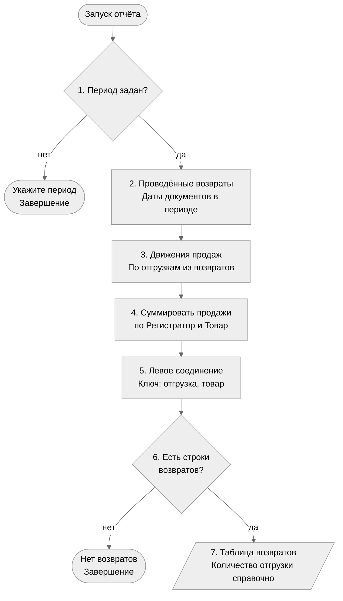
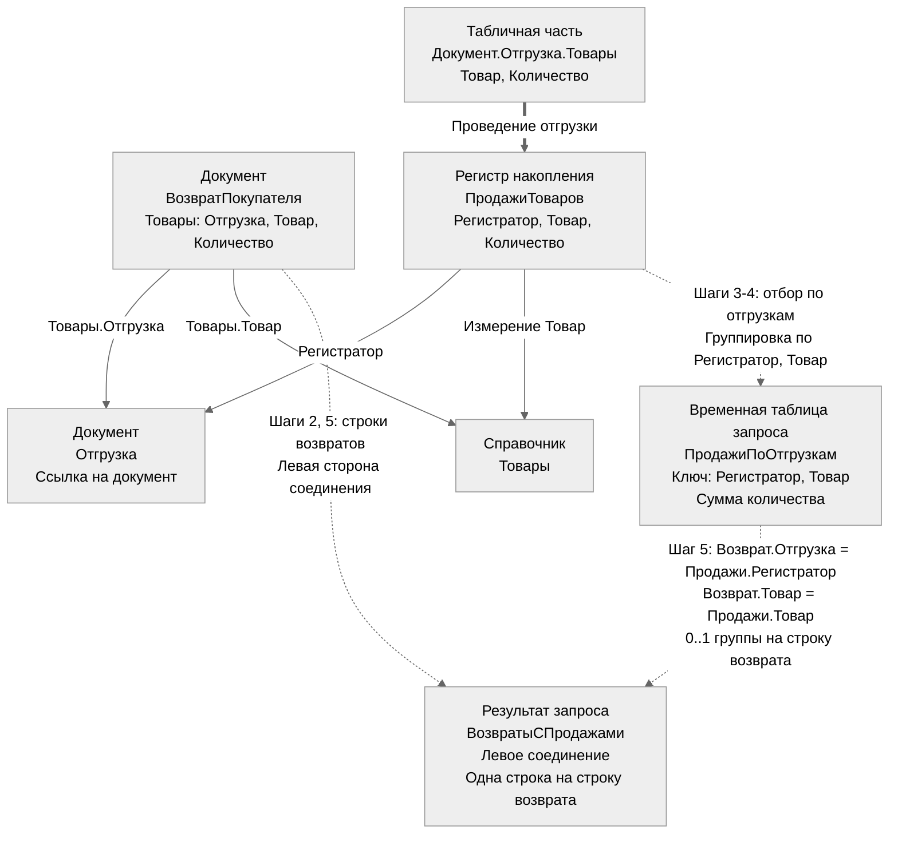

# Схемы объектов и связей 1С

Эти правила применяются к техническим схемам для аналитика 1С и разработчика.
В пакете для заказчика такие схемы размещаются в техническом приложении.
Договорённости обозначений указываются в легенде конкретного рисунка.

## Выбрать предмет схемы

Обзор процесса показывает входные параметры, команды и результаты. Блок-схема
алгоритма раскрывает порядок действий, условия, циклы и завершение при ошибке.
Карта объектов объясняет источники данных, реквизиты и преобразования запроса.
Для структуры сущностей с атрибутами и кратностью подходит `erDiagram`.
Для карты с разными видами связей подходит `flowchart` с собственной легендой.

Большой алгоритм раскрывается общей схемой и деталями отдельных этапов.
Номера шагов на рисунке совпадают с номерами в описании. Существенные условия
имеют отдельные ветви с подписями исходов. Правила открытия и завершения файлов
показываются в том порядке, в котором выполняется алгоритм.

Существующая и предлагаемая модели получают отдельные заголовки и статус.
Условия применения предлагаемого механизма указываются рядом с ним.

## Подписать объекты

В блоке указываются вид метаданных, точное имя и роль в рассматриваемой функции.
Для регистра указывается его вид, например «Регистр накопления» или
«Регистр сведений». Для показанной части объекта указывается полный путь,
например `Документ.Отгрузка.Товары` и «Табличная часть».

Ссылка на объект и табличная часть имеют собственные роли. Если на рисунке
они показаны двумя блоками, подписи объясняют, что это части одного документа.
Временная таблица и результат запроса обозначаются именно как данные запроса.

Для каждого поля показывается его владелец. Например, дата документа находится
в шапке, а количество товара может находиться в строке табличной части.
Перечень полей выбирается по цели рисунка.

## Различать связи

В примерах ниже используется следующая легенда.

| Обозначение | Смысл | Подпись |
|---|---|---|
| Сплошная стрелка `-->` | Хранимая ссылка от владельца реквизита к объекту | Путь реквизита или измерения |
| Толстая стрелка `==>` | Запись движений | Действие, формирующее записи регистра |
| Пунктирная стрелка `-.->` | Получение данных запросом | Отбор, ключ соединения или группировка |

Для соединения указываются обе стороны равенства и значимые части ключа.
Например, `Возврат.Отгрузка = Продажи.Регистратор` и
`Возврат.Товар = Продажи.Товар`. Уточняется вид соединения и ожидаемое число
совпадений для одной строки. Оно определяется ключами, отборами и группировкой.

При размножении строк показывается, какие исходные значения повторяются.
При группировке перечисляются ключ и агрегируемые показатели. Кратность
связи проверяется по условиям рассматриваемого запроса.

## Проверить основание связи

Тип ссылки сверяется с метаданными конкретной версии конфигурации. Заполнение
реквизита и значение связи для функции проверяются по коду и доступным данным.
Для регистров прослеживаются формирование записей и чтение потребителем.
Если распределение или расчёт меняют данные, учитывается и этот этап.

Например, наличие серии в оперативном движении само по себе даёт сведения
только об этом движении. Состав аналитики после расчёта определяется отдельно.
В описании связи указываются существенные условия её заполнения.

Составная ссылка раскрывается по допустимым типам. Набор полей каждого типа
проверяется отдельно. В условной конфигурации реквизит `Справочник.Партии.Основание`
может принимать `ДокументСсылка.Поступление` и
`ДокументСсылка.ВводНачальныхОстатков`. Если `Поставщик` есть у поступления,
его получение на схеме показывается через ветвь этого типа документа.

Основания и границы проверки собираются в описании модели. У подписей стрелок
остаются реквизиты, ключи и действия. Техническое утверждение, которое ещё
требует проверки, обозначается по правилам исходного документа и связывается
с конкретным вопросом или действием проверки.

## Учебные условия двух примеров

Имена объектов и правила ниже заданы для вымышленной конфигурации. Они служат
исходным описанием обоих рисунков.

1. В `Документ.Отгрузка.Товары` есть поля `Товар` и `Количество`. При проведении
   каждая строка записывает движение в `РегистрНакопления.ПродажиТоваров`.
   В записи находятся `Регистратор`, измерение `Товар` и ресурс `Количество`.
2. В `Документ.ВозвратПокупателя.Товары` есть поля `Отгрузка`, `Товар` и
   `Количество`. Поле `Отгрузка` ссылается на документ отгрузки. Поля `Товар`
   обоих документов и регистра ссылаются на `Справочник.Товары`.
3. Период отчёта ограничивает даты проведённых возвратов. Движения продаж
   отбираются по указанным в возвратах отгрузкам. Их даты могут быть раньше
   начала периода возвратов.
4. Продажи суммируются по `Регистратор, Товар`. Строки возврата соединяются
   с группами продаж левым соединением по отгрузке и товару.
   Левая сторона соединения - строки возврата. Для неё находится от нуля до
   одной группы продаж.
5. Строка результата соответствует строке возврата. В ней показаны товар,
   отгрузка, количество возврата и справочное количество отгрузки. При
   отсутствии группы продаж справочный показатель остаётся пустым.
   Общий итог количества возврата суммируется по строкам. Справочное количество
   отгрузки относится к ключу `Отгрузка, Товар`. При подсчёте общего количества
   отгрузки каждая группа учитывается один раз по этому ключу.
6. При незаданном периоде выводится «Укажите период», при отсутствии возвратов
   выводится «Нет возвратов». Оба случая завершают команду.

### Пример 1. Алгоритм учебного отчёта

На шаге 3 действует отбор по отгрузкам выбранных возвратов. Временной отбор
шага 2 относится к документам возврата. Это две самостоятельные области отбора.

### Пример 2. Объекты и преобразования запроса

В условиях соединения `Возврат` обозначает строки возврата, а `Продажи`
обозначает сгруппированную временную таблицу `ПродажиПоОтгрузкам`.

Блоки `Документ.Отгрузка.Товары` и `Отгрузка` показывают табличную часть
и ссылку одного вида документа. Запись движений, ссылки и действия запроса
имеют разные обозначения по легенде.

**Контроль соединения.** В отгрузке две строки одного товара с количествами
3 и 7. В возврате одна строка этого товара с количеством 2. Соединение с
исходными движениями по отгрузке и товару даст две строки, в каждой повторится
количество возврата 2. Его сумма по результату станет 4. В описанном учебном
алгоритме предварительная группировка даёт одну запись продаж с количеством
10. Результат содержит одну строку возврата с количеством 2 и справочным
количеством отгрузки 10.

## Проверить готовую схему

- По рисунку прослеживается путь от параметров до результата или отказа.
- У каждого объекта понятны вид, имя и роль. У поля указан владелец.
- Подписи и начертание стрелок соответствуют легенде.
- Для соединения видны ключи, область отборов и возможное размножение строк.
- Группировка показывает ключ и агрегируемые показатели.
- Статус предлагаемой модели и условия её применения указаны явно.
- Рисунок открыт в конечном масштабе, подписи и ветви читаются, наложения
  и обрезанные элементы устранены.
